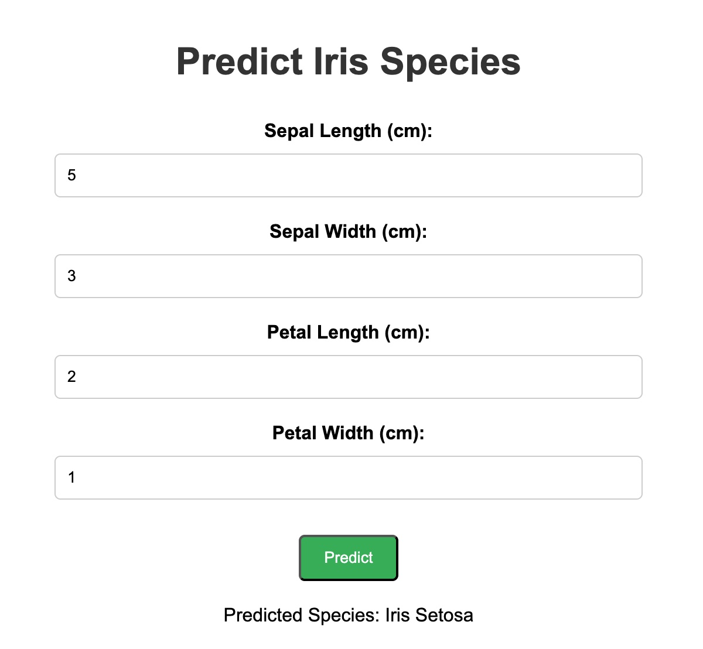

# Iris Species Predictor


A small machine learning web app that predicts the species of an iris flower from four measurements. A support vector machine (SVM) model built with scikit-learn is served through a FastAPI app with a simple web page, and the whole app is packaged with Docker.

The app classifies flowers as **Iris Setosa**, **Iris Versicolor**, or **Iris Virginica**.



## Tech stack

- **Model:** scikit-learn, pandas, NumPy, joblib
- **API and web app:** FastAPI, Uvicorn, HTML, CSS
- **Packaging:** Docker (Python 3.14 slim image)

## Quick start with Docker

You need [Docker](https://docs.docker.com/get-docker/) installed and running.

```bash
git clone https://github.com/ykpciftci/ml-docker.git
cd ml-docker
docker build -t iris-app .
docker run --rm -p 8000:8000 iris-app
```

Then open <http://localhost:8000>. Press `Ctrl + C` in the terminal to stop the app. If it keeps running, use `docker ps` to find the container ID and `docker stop <container_id>` to stop it.

The container runs as a non-root user and reports its health through `/health`.

## Run without Docker

You need Python 3.14.

```bash
git clone https://github.com/ykpciftci/ml-docker.git
cd ml-docker
python3 -m venv myenv
source myenv/bin/activate
pip install -r requirements.txt
uvicorn main:app --reload
```

Then open <http://localhost:8000>. On Windows, activate the environment with `myenv\Scripts\activate` instead.

## Running the tests

```bash
pip install -r requirements-dev.txt
python -m pytest -q
```

The tests cover the model's predictions for each species, input validation, the API endpoints and the training code. They also run automatically on every push through GitHub Actions.

## Using the app

| Method | Path | Description |
| ------ | ---- | ----------- |
| `GET` | `/` | Home page |
| `GET` | `/predict` | Page with the prediction form |
| `POST` | `/predict` | Returns a prediction as JSON |
| `GET` | `/docs` | Interactive API documentation |
| `GET` | `/health` | Health check |

`POST /predict` takes a JSON body. All four fields are required and are measured in centimeters:

```bash
curl -X POST http://localhost:8000/predict \
  -H "Content-Type: application/json" \
  -d '{"SepalLengthCm": 5.1, "SepalWidthCm": 3.5, "PetalLengthCm": 1.4, "PetalWidthCm": 0.2}'
```

Response:

```json
{"prediction": "Iris Setosa"}
```

Missing or non-numeric fields and values that aren't above 0 and at most 15 return a `422` error.

## The model

The model is trained in [`train.py`](train.py) on the classic Iris dataset [`Iris.csv`](Iris.csv), which has 150 flowers, 50 from each species.

- **Algorithm:** `StandardScaler` followed by an SVM with an RBF kernel (`C=1.0`, `gamma='scale'`)
- **Evaluation:** 5-fold stratified cross-validation, repeated 10 times
- **Accuracy:** 96.2% ± 3.3%, compared with a 33.3% baseline
- **Final model:** trained on all 150 flowers

The Iris dataset is small and easy to classify, so this score shows that the pipeline works rather than how the model would perform on harder, real-world data.

### Retraining

The trained model is saved as `model.pkl`, so you don't need to retrain it to run the app. To retrain it:

```bash
python train.py
```

To open the notebook, you need these packages:

```bash
pip install notebook matplotlib seaborn
```

`requirements.txt` pins `scikit-learn==1.9.0`, the version that saved the current model. If you retrain with a different version, update the pin to match.

## Project structure

```
.
├── main.py                 # FastAPI app and prediction endpoint
├── train.py                # Model training
├── model.pkl               # Trained pipeline (scaler and SVM)
├── Iris.csv                # Dataset
├── iris-classifier.ipynb   # Data exploration
├── static/
│   ├── index.html          # Home page
│   ├── predict.html        # Prediction form
│   └── styles.css          # Styles
├── test_unit.py            # Unit tests for individual components
├── test_integration.py     # Integration tests for combined systems
├── test_train.py           # Test for the ML model training pipeline
├── requirements.txt        # Python dependencies
├── requirements-dev.txt    # Test dependencies
├── Dockerfile              # Container image definition
├── .dockerignore           # Files left out of the image
└── .github/workflows/
    └── tests.yml           # GitHub Actions workflow for automated testing

```
